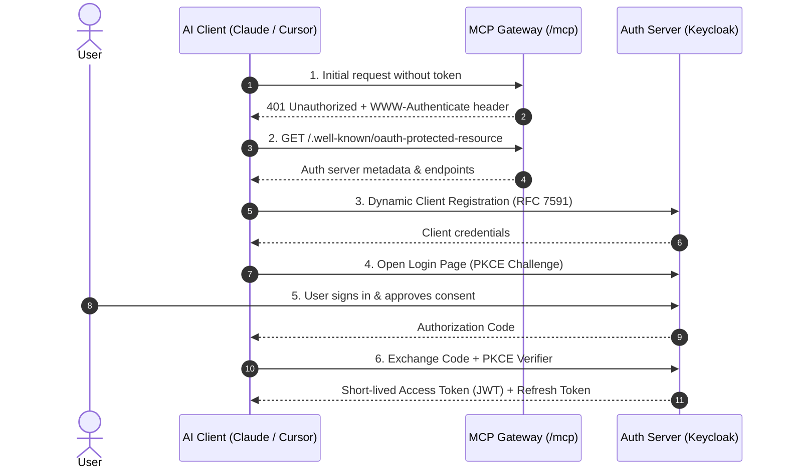
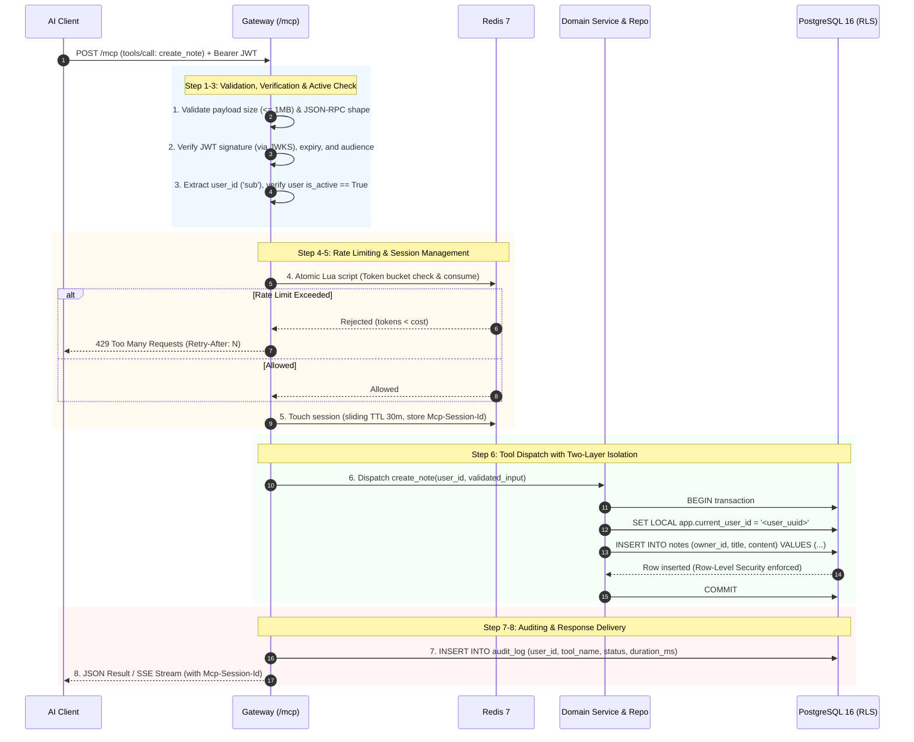

# Remote Multi-Tenant MCP Server

[](https://www.python.org/)
[](https://fastapi.tiangolo.com/)
[](https://modelcontextprotocol.io/)
[-336791.svg)](https://www.postgresql.org/)
[](https://redis.io/)

A secure, centralized [Model Context Protocol (MCP)](https://modelcontextprotocol.io/) server that allows multiple users and teams to safely share tools from their AI assistants (Claude, Cursor, custom agents). Each user logs in through OAuth 2.1, works strictly with their own private data, and enjoys guaranteed isolation, fair rate limits, and audit tracking.

> **Analogy:** Think of it as a company library with membership cards: one building, many members, each with a private locker, a visit limit, and an audit logbook at the door.

---

## 1. What Is This Project?

Traditional MCP servers run locally on individual developer laptops over `stdio`. While suitable for personal experiments, local servers fail in team and enterprise settings:
- **No Shared Tooling:** Every team member must manually install, configure, and maintain local servers.
- **Credential Leak Risk:** Database passwords, service tokens, and API keys are scattered across personal machines.
- **Zero Accountability:** Organizations have no central visibility into which tools AI agents run or what data they manipulate.
- **No Data Isolation:** Local servers lack native multi-tenant boundaries.

This project delivers a **hosted, multi-tenant Remote MCP Server** accessible over standard **Streamable HTTP**. Instead of runningRun these in order. You’re checking each result, not just running commands.

docker compose config prints the final file. If it errors about a missing variable, your .env is missing a key.
docker compose down -v wipes any old volume, so the init script runs on a clean database.
docker compose up -d, then docker compose ps. Both services should show healthy.
docker compose logs postgres should show your init script running, with no errors. If you see “bad interpreter” or “required file not found”, the script has Windows (CRLF) line endings. Re-save it as LF.
docker compose exec postgres psql -U <your superuser> -c "\du" should list app_user and app_admin with no Superuser or Bypass RLS attributes.
Test the app role’s password: run docker compose exec -e PGPASSWORD=<app_user password> postgres psql -h 127.0.0.1 -U app_user -d <db> -c "select current_user;". The -h 127.0.0.1 matters. Without it, psql uses the local socket, which doesn’t check the password, so a wrong password would still pass.
Redis auth: docker compose exec redis redis-cli ping should be refused with NOAUTH. With -a <password> it should return PONG. tools locally, users connect their AI assistants to one remote URL, authenticate via standard OAuth 2.1 with PKCE, and execute tools securely in the cloud.

---

## 2. Core Use Cases

### Use Case 1: Shared Team Tools Without Credential Sprawl
A company deploys one central MCP server. Team members add a single server link to Claude or Cursor. Nobody stores database passwords or backend tokens on their laptops; the server delegates identity to the central identity provider (Keycloak / OAuth).

### Use Case 2: Strict Multi-Tenant Private Notes & Tasks
Multiple users (e.g., Ali and Sara) use the same server to take notes and organize tasks via their AI assistants:
- Ali asks Claude: *"Save a note about project roadmap."*
- Sara asks Cursor: *"List my recent notes."*
- **Guarantee:** Sara never sees Ali's notes. Even if a user's client maliciously crafts requests with another user's note ID, the server returns "Not Found" through multi-layer isolation.

### Use Case 3: Enterprise Compliance & Audit Trail
IT and security teams require oversight over agent actions:
- Every tool invocation records user identity, tool name, execution duration, and status in an immutable audit log.
- Users can review their own history via `get_my_activity`.
- Admins can inspect system-wide activity, disable abusive accounts, or revoke tokens without affecting other tenants.

### Use Case 4: Fair Usage & Rate-Limiting Protection
An automated agent or power user might trigger hundreds of rapid tool calls:
- The server applies a **Token Bucket rate limiter per user** (e.g., 20 burst, 60 requests/min, writes cost 2 tokens).
- If one user exceeds their quota, they receive an HTTP `429 Too Many Requests` with a clear `Retry-After` header. Other users remain completely unaffected.

### Use Case 5: Resilient Long-Running Streams & Resumption
When an AI assistant triggers a tool that streams data:
- The server streams events via Server-Sent Events (SSE) with incrementing event IDs.
- If the user's internet connection drops mid-stream, the AI client reconnects using the `Last-Event-ID` header. The server replays missed events from a Redis buffer so the stream finishes without losing work.

---

## 3. End-to-End System Flows

### Flow 1: Connection & OAuth 2.1 PKCE Authentication (Once per Client)
The client automatically discovers authentication metadata and guides the user through sign-in without the MCP server ever seeing the user's password:



---

### Flow 2: Authenticated Tool Execution Pipeline (Every Request)
Every incoming tool call passes through an 8-step pipeline before touching database rows:



---

### Flow 3: Connection Interruption & Stream Resumption
If a network disconnect occurs during a streamed response:
1. The server buffers recent stream events in Redis (`events:{session_id}`) with a capped length and short TTL.
2. The AI client reconnects and provides `Last-Event-ID: <id>` and `Mcp-Session-Id: <session_id>`.
3. The gateway verifies session ownership matches the bearer token, retrieves only the missing events from Redis, and resumes streaming to the client without re-executing the tool.

---

## 4. Multi-Tenancy & Data Isolation Model

To guarantee zero cross-tenant data leaks, the architecture implements **defense-in-depth**:

| Layer | Mechanism | How It Works |
|---|---|---|
| **Layer 1: Application** | Required Parameter Filtering | Every repository query requires `user_id` extracted exclusively from the validated JWT token (`sub`). No tool schema accepts a user or owner ID from the AI client. |
| **Layer 2: Database** | PostgreSQL Row-Level Security (RLS) | Tables (`notes`, `tasks`, `audit_log`) enforce `FORCE ROW LEVEL SECURITY`. Every transaction sets `SET LOCAL app.current_user_id = '<uuid>'`. If the variable is missing or mismatched, PostgreSQL returns 0 rows. |
| **Separation of Roles** | Dedicated DB Roles | Normal requests connect via `app_user` (`NOBYPASSRLS`). Administrative auditing uses a separate `app_admin` pool with strict read-only policies. |
| **Anti-Enumeration** | Identical "Not Found" Responses | Accessing or attempting to alter another tenant's record returns a generic "Not Found" error rather than "Forbidden", preventing user enumeration. |

---

## 5. Tool Catalog (Version 1)

| Tool | Purpose | Inputs | Returns |
|---|---|---|---|
| `create_note` | Save a private note | `title` (1–200 chars), `content` (up to 10k chars) | Note ID |
| `list_notes` | List or search user's notes | `query` (optional), `limit` (default 20) | Array of note summaries |
| `get_note` | Retrieve full note by ID | `id` (UUID) | Full note content |
| `delete_note` | Delete a note by ID | `id` (UUID) | Confirmation |
| `add_task` | Track a task with optional due date | `title`, `due_date` (optional ISO date) | Task ID |
| `list_tasks` | List user tasks | `status` (open / done), `limit` | Array of tasks |
| `complete_task` | Mark a task as done | `id` (UUID) | Confirmation |
| `get_my_activity` | Review own recent tool executions | `limit` (default 20) | Array of audit events |

---

## 6. Getting Started

### 1. Prerequisites
- [Docker Desktop](https://www.docker.com/products/docker-desktop/) (v24+)
- [Python 3.12+](https://www.python.org/)

### 2. Configure Environment
```bash
cp .env.example .env
```
Ensure all required passwords in `.env` are set (`POSTGRES_PASSWORD`, `APP_USER_PASSWORD`, `APP_ADMIN_PASSWORD`, `REDIS_PASSWORD`).

### 3. Start PostgreSQL and Redis
```bash
docker compose up -d
```
Verify that both containers report `(healthy)`:
```bash
docker compose ps
```
- PostgreSQL is bound to `127.0.0.1:5433` (configured with `app_user` and `app_admin` roles).
- Redis is bound to `127.0.0.1:6379` (password protected, 128MB LRU memory cap).

### 4. Install Dependencies
```bash
python -m venv .venv
# On Windows:
.venv\Scripts\Activate.ps1
# On Linux/macOS:
source .venv/bin/activate

pip install -r requirements.txt
```

---

## 7. Version 1 Roadmap

- [x] **Phase 0: Setup** — Docker Compose (Postgres RLS roles, Redis auth/capping), environment configuration, project documentation.
- [ ] **Phase 1: Basic MCP Server** — Minimal FastAPI server with Streamable HTTP transport, dummy tool, and `/health`.
- [ ] **Phase 2: Database and Tools** — Schema migrations, Pydantic validation, and domain tools (`notes`, `tasks`) with test user context.
- [ ] **Phase 3: Authentication** — Keycloak OAuth 2.1 integration, PKCE flow, JWKS verification, and dynamic user provisioning.
- [ ] **Phase 4: Data Isolation** — Application filter enforcement, PostgreSQL Row-Level Security (`FORCE RLS`), and automated cross-tenant test suite.
- [ ] **Phase 5: Rate Limiting** — Redis Token Bucket with Lua script (20 burst, 60/min, 2 per write) and `429 Retry-After` handling.
- [ ] **Phase 6: Sessions & Resumable Streaming** — Redis session store, `Mcp-Session-Id`, and SSE event stream resume via `Last-Event-ID`.
- [ ] **Phase 7: Audit & Observability** — Execution logging in `audit_log`, `get_my_activity` tool, Prometheus metrics, and Grafana dashboard.
- [ ] **Phase 8: Admin Management** — Dedicated `app_admin` pool, user disabling, and token revocation.
- [ ] **Phase 9: Testing & Release** — Full test coverage, Locust 50-user load test (verifying 0 cross-tenant leaks), and end-to-end demo script.

---

## License

Internal / MIT License. Designed for private, multi-user AI tool integration.
