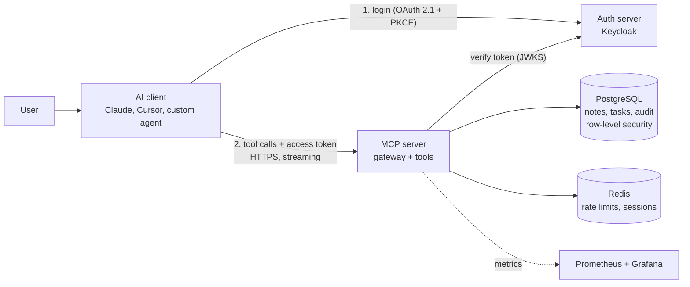
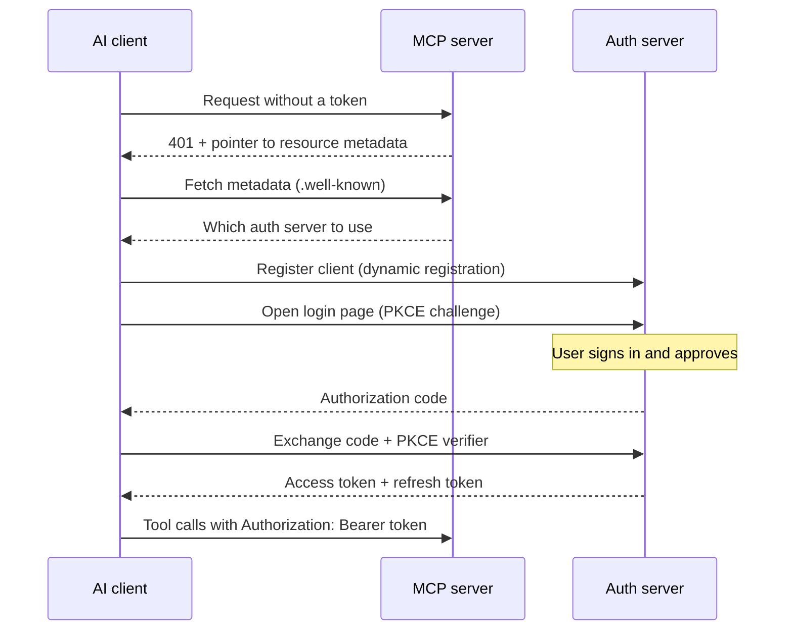
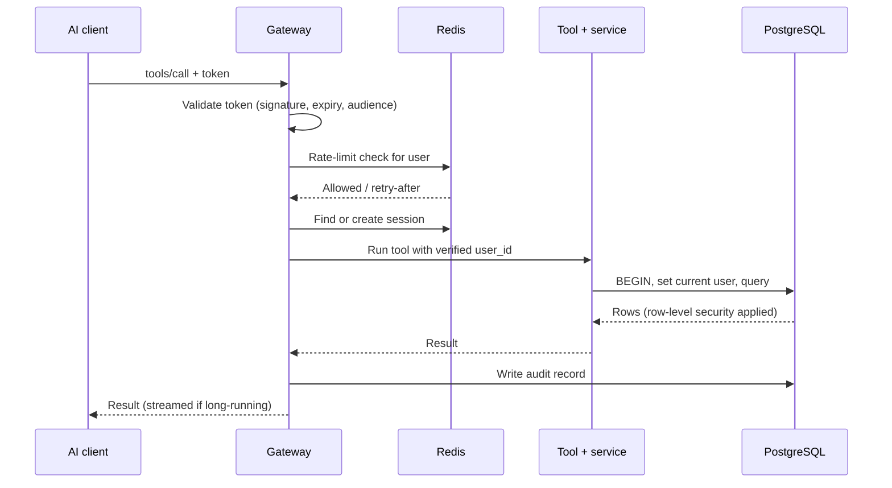
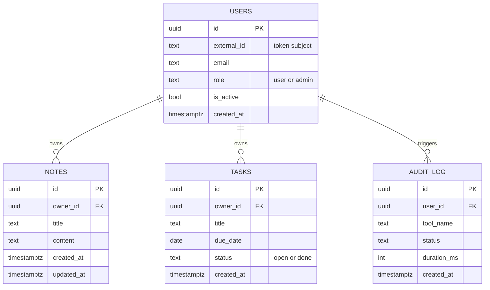

# Architecture: Remote Multi-Tenant MCP Server (Version 1)

| | |
|---|---|
| **Status** | Draft for v1 |
| **Scope** | Version 1 only. Reminders, files, teams, and the web UI are v2 |
| **Audience** | Developers and reviewers. Section 1 is readable by non-technical people |

---

## 1. Overview

This project is a **hosted MCP server** that many users share. AI assistants (Claude, Cursor, custom agents) connect to it over HTTP. Each user logs in, gets private data, and can never see anyone else's. The server limits how much each user can do and records every action.

**In one sentence:** one company library, many members, each with a private locker, a visit limit, and a logbook at the door.

### Goals

- Many users share one hosted MCP server using a link and a login
- Strong, provable data isolation between users
- Fair per-user rate limits
- Reliable sessions and streaming
- Full audit trail of tool calls
- Runs entirely on free tools

### Non-goals (v1)

- Reminders and notifications
- File storage, teams, shared notes
- A web UI (users interact through their AI client)
- Calling any LLM from the server (it is LLM-agnostic and needs no AI API key)
- Billing

---

## 2. System Context



**Trust boundaries**

- The AI client is **untrusted**. It can send anything, including a fake `owner_id`.
- The server trusts only the **verified token**, never fields inside a tool call.
- The database is the last line of defense (row-level security).

---

## 3. Components

| Component | Responsibility | Technology |
|---|---|---|
| **AI client** | Talks to the user, discovers tools, sends tool calls | Claude, Cursor, MCP Inspector |
| **Auth server** | Login, client registration, issues and revokes tokens | Keycloak (self-hosted) |
| **MCP gateway** | Single entry point: token check, rate limit, sessions, routing | Python, FastAPI, official MCP SDK |
| **Tool layer** | Notes, tasks, and activity tools | Python modules |
| **PostgreSQL** | Durable data, audit log, row-level security | PostgreSQL |
| **Redis** | Rate-limit counters, session state, short event buffer | Redis |
| **Observability** | Metrics, dashboards, health checks | Prometheus, Grafana |

---

## 4. Code Structure (Modular Monolith)

One deployable app, organized by feature. A module can be split into its own service later without a rewrite.

```
remote-mcp-server/
├── infra/                      # docker, keycloak realm, postgres init, monitoring
├── migrations/                 # Alembic
├── src/
│   ├── app/                    # entry point, wiring, settings
│   ├── shared/                 # db pool, redis client, errors, logging
│   └── modules/
│       ├── auth/               # token validation, discovery metadata, users
│       ├── gateway/            # MCP endpoint, sessions, request pipeline
│       ├── ratelimit/
│       ├── audit/
│       ├── admin/
│       ├── notes/              # tools.py, service.py, repository.py, schemas.py
│       ├── tasks/              # same shape as notes
│       └── activity/           # get_my_activity
└── tests/                      # mirrors modules/, plus isolation/ and load/
```

**Rules**

- Modules call each other through `service.py`, never through another module's repository.
- Tool files stay thin: validate input, call the service, return the result.
- Only the gateway and `auth` read tokens. Everything else receives a verified `user_id`.
- Only `repository.py` files write SQL.

---

## 5. Key Flows

### 5.1 Connect and log in (once per user)



- The MCP server never sees the user's password.
- Access tokens are short-lived. The client refreshes them with the refresh token.
- The access token's audience must be this MCP server's address.
- Check the current MCP authorization spec before implementing, since details evolve.

### 5.2 Tool call (every request)



**Failure paths**

| Situation | Response |
|---|---|
| Missing, expired, forged, or wrong-audience token | `401 Unauthorized` |
| Rate limit exceeded | `429 Too Many Requests` with `Retry-After` |
| Invalid tool input | Structured tool error with a clear message |
| Record missing or owned by someone else | "Not found" (never "forbidden") |
| Unexpected failure | Generic error to client, details in server logs only |

---

## 6. Data Model



**Notes**

- IDs are UUIDs, so they cannot be guessed in sequence.
- `users` rows are created on a user's first valid request, linked to the token's subject.
- Index `owner_id` on `notes` and `tasks`, and `(user_id, created_at)` on `audit_log`.
- `audit_log` stores no note or task content.

**Redis keys**

| Key | Purpose | Lifetime |
|---|---|---|
| `rl:{user_id}` | Rate-limit bucket | Expires when idle |
| `session:{session_id}` | User, client, last seen | Sliding expiry (about 30 min) |
| `events:{session_id}` | Short buffer of recent stream events for resume | Capped length, expires with session |

---

## 7. Multi-Tenancy and Isolation

Two independent layers, so one bug cannot cause a leak.

**Layer 1: application**

- Every repository query takes `owner_id` as a required parameter and filters on it.
- `owner_id` comes only from the verified token, never from tool input.

**Layer 2: database (row-level security)**

- Each request opens a transaction and sets the current user, for example `SET LOCAL app.current_user_id = '<uuid>'`.
- Policies on `notes`, `tasks`, and `audit_log` allow rows only where `owner_id` (or `user_id`) equals that setting.
- The app connects as a normal role **without** superuser or bypass rights. Use `FORCE ROW LEVEL SECURITY` so even the table owner is restricted.
- If the setting is missing, no rows match.

**Proof:** automated tests where user A attempts to read, update, and delete user B's records by ID. Every attempt must return "not found".

---

## 8. Rate Limiting

- **Algorithm:** token bucket per user, stored in Redis, updated atomically (Lua script) so it is correct across multiple server copies.
- **Defaults (configurable):** burst of about 20 calls, refill of about 60 per minute.
- **On limit:** return `429` with `Retry-After`.
- **Fairness:** limits are per user, so one heavy user cannot slow others.
- **If Redis is down:** fail closed for writes, with a short documented grace policy for reads. Decide and document this choice.

---

## 9. Sessions and Streaming

- The MCP endpoint uses **Streamable HTTP**. Long-running results stream back as server-sent events.
- Each session has an ID, stored in Redis with the owning `user_id`. A session ID alone never grants access: the token must match the session's owner.
- Streamed events carry IDs and are buffered briefly in Redis, so a client that reconnects can resume from the last event it received.
- Idle sessions expire automatically. Because state lives in Redis, any server copy can serve any session.

---

## 10. Audit and Observability

**Audit**

- One record per tool call: user, tool, status, duration, time.
- Never log tokens, secrets, or full note content.
- `get_my_activity` shows users their own records. Admins can query all.

**Observability**

- `GET /health` for liveness and dependency checks (Postgres, Redis).
- `GET /metrics` for Prometheus: request count, latency histogram, error rate, rate-limit hits, active sessions.
- Structured JSON logs with a request ID.
- A Grafana dashboard for traffic, latency, errors, and limit hits.

---

## 11. Interfaces

| Endpoint | Purpose | Access |
|---|---|---|
| `POST /mcp` (and its stream) | MCP messages: `initialize`, `tools/list`, `tools/call` | Valid token |
| `GET /.well-known/oauth-protected-resource` | Tells clients which auth server to use | Public |
| `GET /health` | Health check | Public |
| `GET /metrics` | Prometheus metrics | Internal network only |
| `/admin/...` | List users, usage, disable user, revoke tokens | Admin role |

**v1 tools**

| Tool | Inputs | Returns |
|---|---|---|
| `create_note` | title, content | Note ID |
| `list_notes` | optional search text | The user's notes |
| `get_note` | note ID | One note, if owned by the user |
| `delete_note` | note ID | Confirmation |
| `add_task` | title, optional due date | Task ID |
| `list_tasks` | optional status | The user's tasks |
| `complete_task` | task ID | Confirmation |
| `get_my_activity` | optional limit | Recent audit entries for the user |

`add_task` stores a due date but sends no reminders in v1.

---

## 12. Security

| Threat | Mitigation |
|---|---|
| Cross-user data access | Two-layer isolation, UUIDs, isolation tests |
| Stolen or forged token | Short lifetimes, signature check against the auth server's keys, strict audience check, revocation |
| Client sends a fake user ID | Server ignores it and uses the token's identity |
| Prompt injection via stored notes | Tools return stored text as plain data; v1 tools only touch the caller's own data, limiting damage |
| Abuse and overload | Per-user rate limits, request size limits, ability to disable users |
| Secret leakage | Secrets only in environment variables, never in logs or the repo |
| Transport attacks | HTTPS only, strict CORS |
| Bad input | Schema validation and length limits on every tool input |

---

## 13. Non-Functional Targets

| Area | Target |
|---|---|
| Latency | Typical tool call under 300 ms at normal load; rate-limit check under 10 ms |
| Scalability | Stateless app copies; shared state in Redis and PostgreSQL |
| Reliability | No duplicate writes on retries; sessions survive dropped connections |
| Availability | Health checks and automatic restart (best effort on free hosting) |
| Privacy | Users see only their data; logs avoid personal content |
| Maintainability | Module boundaries, automated tests, documented setup |
| Compatibility | Works with any standards-compliant MCP client |
| Cost | $0 using free tools and free tiers |

These are starting targets. Confirm or revise them after the load test.

---

## 14. Deployment

**Local (primary)**: one `docker-compose.yml` runs:

- `app` (the MCP server)
- `postgres`
- `redis`
- `keycloak`
- `prometheus` and `grafana`

**Public demo (optional)**

- Free-tier host for the app, with managed or free-tier Postgres and Redis
- A tunnel (for example Cloudflare Tunnel) if a public HTTPS URL is needed
- Known limits: free hosts may sleep when idle and cap connections. State this in the README.

**Configuration**: environment variables only (database URL, Redis URL, auth server URL, expected audience). Provide `.env.example`, never commit real secrets.

---

## 15. Testing Strategy

| Type | What it proves |
|---|---|
| Unit | Tools and validation behave correctly |
| Isolation | User A cannot read, change, or delete user B's data |
| Auth | Expired, forged, and wrong-audience tokens are rejected |
| Rate limit | Limit triggers, `Retry-After` is correct, bucket refills |
| Session | A dropped connection resumes without losing results |
| Load | Stable under many concurrent users; bottlenecks documented |
| Manual | A real AI client works end to end |

---

## 16. Design Decisions and Trade-offs

| Decision | Why | Trade-off |
|---|---|---|
| Modular monolith | Simple to run, easy to split later | Discipline needed to keep module boundaries |
| Existing auth server (Keycloak) | OAuth is hard; avoid writing a custom one | Extra service to run and learn |
| Row-level security plus app filters | A bug in one layer does not cause a leak | Slightly more setup and per-request overhead |
| Redis for limits and sessions | Shared across app copies, fast | Another dependency; needs a fail-closed policy |
| "Not found" for others' records | Does not reveal that records exist | Slightly less specific errors |
| No LLM inside the server | Simpler, cheaper, client-agnostic | Fewer built-in "smart" tools |
| UUID identifiers | Not guessable | Larger indexes than integers |

---

## 17. Risks

| Risk | Mitigation |
|---|---|
| OAuth for MCP is complex and clients differ | Use Keycloak, follow the current spec, test with several clients |
| A missed filter leaks data | RLS plus isolation tests in CI |
| Streaming and resume bugs | Redis event buffer, explicit disconnect tests |
| Race conditions under load | Transactions, atomic Redis operations, load testing |
| Free hosting limits | Document them and demo locally if needed |
| Scope creep | Hold to the v1 list and `ROADMAP.md` |

---

## 18. Evolution (After v1)

- **Reminders:** a background scheduler, a notification channel, and a flag to prevent duplicates
- **Web UI:** a small REST API and React page reading the same data, with the same auth and isolation
- **Files, teams, and roles**
- **Plugin-style tools:** let tools self-register so the core never changes when adding one
- **Splitting services:** move the gateway and heavy modules into separate services if traffic requires it

---

## 19. Glossary

- **MCP:** a standard way for AI assistants to use tools
- **Tool call:** a request from the AI client to run one tool
- **OAuth 2.1 / PKCE:** the secure login standard; PKCE protects the login code exchange
- **Access token (JWT):** a short-lived signed pass identifying the user
- **Multi-tenancy:** many users share one system while their data stays separate
- **Row-level security (RLS):** a database feature that hides rows from users who do not own them
- **Token bucket:** a rate-limit method that allows short bursts, then a steady rate
- **Session:** an ongoing connection between a client and the server
- **SSE:** server-sent events, a way to stream results over HTTP
- **Audit log:** a record of who did what and when
